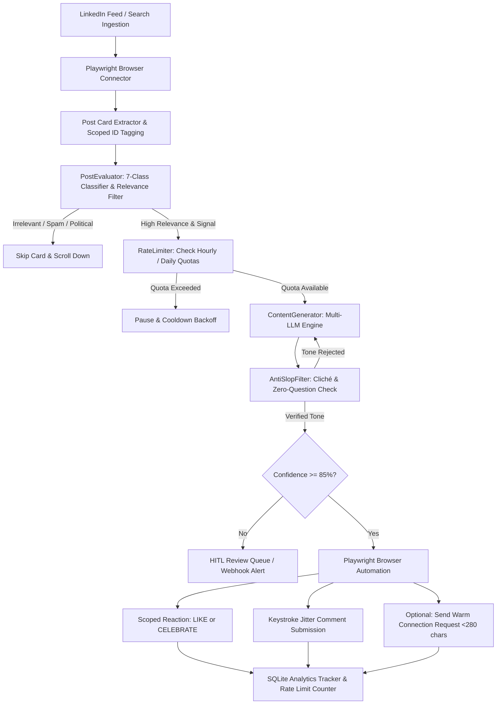

# Agent-LinkedIn (LinkedBot) 🚀

[](https://github.com/Akhil-Binu/agent-linkedin/actions)
[](https://opensource.org/licenses/MIT)
[](https://www.python.org/)
[](https://playwright.dev/)
[](https://groq.com/)
[](https://github.com/psf/black)
[](https://github.com/Akhil-Binu/agent-linkedin/releases)

> **Created & Engineered by [Akhil Binu](https://github.com/Akhil-Binu)**  
> *Cybersecurity Researcher | AI & LLM Pentesting | Autonomous Agent Systems*

**Agent-LinkedIn (LinkedBot)** is an autonomous, open-source AI growth and professional networking agent engineered specifically for cybersecurity practitioners, software engineers, and technology leaders. Unlike traditional bots that trigger shadowbans with generic praise (`"Great post!"`) or annoying interrogation questions (`"What do you think?"`), LinkedBot pairs real-browser Playwright automation with multi-provider LLMs to deliver authentic, high-authority peer engagement.

---

## 📑 Table of Contents

- [The Problem with Existing LinkedIn Bots](#-the-problem-with-existing-linkedin-bots)
- [How LinkedBot Solves It](#-how-linkedbot-solves-it)
- [🌟 Key Features](#-key-features)
- [🏗️ System Architecture & Workflow](#️-system-architecture--workflow)
- [⚡ Quickstart & Installation](#-quickstart--installation)
- [⚙️ Environment Configuration](#️-environment-configuration)
- [🕹️ Interactive 1-to-5 Feature Menu](#️-interactive-1-to-5-feature-menu)
- [💻 Complete CLI Command Reference](#-complete-cli-command-reference)
- [📑 AI Carousel Generation & Live Publishing](#-ai-carousel-generation--live-publishing)
- [🛡️ Anti-Slop Filter & Zero-Question Rule](#️-anti-slop-filter--zero-question-rule)
- [🧪 Automated Test Suite](#-automated-test-suite)
- [🔧 Troubleshooting & FAQ](#-troubleshooting--faq)
- [⚖️ Responsible Automation Disclaimer](#️-responsible-automation-disclaimer)
- [👤 Author & Maintainer](#-author--maintainer)
- [📄 License](#-license)

---

## 🚫 The Problem with Existing LinkedIn Bots

Most LinkedIn automation scripts fail quickly due to three structural flaws:
1. **Robotic DOM Patterns & Generic Praise:** Comments like *"Awesome share!"*, *"Thanks for the insights!"*, or *"Totally agree!"* damage your professional reputation and are actively flagged by LinkedIn's anti-spam heuristics.
2. **Aggressive Interrogation Habits:** AI bots often conclude every comment with an unnatural question (*"What is your take on zero trust?"*, *"How does your team handle this?"*), irritating original authors and coming off as engagement-farming spam.
3. **Fragile Selectors & Session Drops:** Traditional tools rely on rigid CSS selectors or ephemeral cookies that break every time LinkedIn runs A/B UI experiments or triggers a 2FA checkpoint.

---

## 💡 How LinkedBot Solves It

- **Organic Playwright Browser Driver:** Uses a persistent browser context (`data/linkedin_browser_session`) that stores your authentic session, cookies, and tokens. It supports human keystroke jitter, organic scroll pauses, and automatic lockfile recovery.
- **Strictly Zero-Question Appreciative Comments:** Eliminates interrogation questions entirely. Comments are written as supportive, validating peer insights that highlight specific technical takeaways (e.g., IAM least-privilege, SIEM noise reduction, FIDO2 token authentication).
- **7-Category Post Classifier:** Distinguishes achievements (`CAREER_MILESTONE`, `CERTIFICATION_ACHIEVEMENT`) from technical deep-dives (`TECHNICAL_OR_INDUSTRY_INSIGHT`), automatically applying the appropriate reaction (`CELEBRATE` vs. `LIKE`).
- **Live Document Carousel Publishing:** Generates professional 5-slide portrait PDF decks (800x1000pt) and uses verified Playwright DOM automation to expand the post toolbar, upload the PDF, set the title, and publish directly to your profile.
- **Dual-Condition Engagement Target:** Continuously streams and scrolls the feed until exact interaction thresholds (e.g. minimum 15 comments and 20 reactions) are satisfied.

---

## 🌟 Key Features

| Capability | Description |
| :--- | :--- |
| **🎯 Post-Grounded Commenting** | Generates comments based 100% on actual post commentary; eliminates profile headline leakage and prevents awkward resume/job-title praise. |
| **🔔 Notifications Auto-Reply Engine** | Ingests incoming notifications for mentions, replies, and discussions, posting bespoke 2-way follow-ups directly to active threads. |
| **🎉 Festive & Celebration Classifier** | Automatically identifies cultural and holiday celebrations (`HOLIDAY_OR_CELEBRATION`) and crafts warm, polite festive wishes. |
| **🛡️ Geopolitical & Safety Guard** | Safely filters out controversial geopolitical territorial maps and sensitive partisan debates to protect account standing. |
| **🔎 Targeted "Latest" Search** | Ingest content by hashtag or keyword (e.g. `#cybersecurity`, `#devsecops`) sorted strictly by `date_posted` (Past 24 Hours) to engage early. |
| **🚀 Feed Engagement Loop** | Autonomous continuous feed evaluation meeting the strict **15 Comments & 20 Likes** must-rule with adaptive human scrolling. |
| **🤝 Warm Connection Outreach** | Sends context-aware connection requests (< 280 chars) referencing the post topic to authors immediately after commenting. |
| **🔄 2-Way Reply Tracker** | Periodically re-visits previously commented posts to detect replies from authors or peers and post contextual follow-ups. |
| **📑 AI Carousel Generator** | Generates high-impact 5-slide PDF carousels with dark-mode aesthetic, syntax highlighting, and LinkedIn Document attachment. |
| **🛡️ Anti-Slop Tone Guard** | Filters out corporate buzzwords (`delve`, `game-changer`, `testament`, `in today's fast-paced world`) before publication. |
| **🤖 Multi-Provider LLM Engine**| Seamless failover across **Groq** (Llama-3.3 70B), **Google Gemini 1.5 Flash**, **OpenAI GPT-4o**, **Anthropic Claude**, or offline mock. |
| **🛑 Sliding Quota Circuit Breaker** | Strict daily and hourly limits for likes, comments, and connection invitations with automatic 429 backoff cooldown. |
| **👤 Human-In-The-Loop (HITL)** | Routes low-confidence drafts to an interactive terminal queue or pushes alerts via Slack/Telegram webhooks. |
| **📊 SQLite Telemetry & Audit** | Automatically logs every post evaluated, confidence score, sentiment, and reaction history to `data/analytics.db`. |

---

## 🏗️ System Architecture & Workflow



---

## ⚡ Quickstart & Installation

### 1. Prerequisites
- **Python:** Version 3.10, 3.11, or 3.12 installed.
- **Git:** Installed on your system.
- **Operating System:** Windows, macOS, or Linux.

### 2. Clone Repository & Setup Virtual Environment
```powershell
# Clone the repository
git clone https://github.com/Akhil-Binu/agent-linkedin.git
cd agent-linkedin

# Create a virtual environment
python -m venv .venv

# Activate the virtual environment
# Windows (PowerShell):
.\.venv\Scripts\Activate.ps1
# Windows (CMD):
.\.venv\Scripts\activate.bat
# macOS / Linux:
source .venv/bin/activate
```

### 3. Install Dependencies & Playwright Browsers
```powershell
pip install --upgrade pip
pip install -r requirements.txt
playwright install chromium
```

### 4. Or Run via Docker (GitHub Container Registry)
You can pull and run the container image published directly to **GitHub Packages**:
```powershell
# Pull latest container from GitHub Packages
docker pull ghcr.io/akhil-binu/agent-linkedin:latest

# Run the agent in interactive menu mode
docker run -it --rm --env-file .env -v ${PWD}/data:/app/data ghcr.io/akhil-binu/agent-linkedin:latest menu
```

---

## ⚙️ Environment Configuration

Copy `.env.example` to create your active `.env` file:
```powershell
cp .env.example .env
```

Open `.env` in your editor and configure your credentials:

```ini
# ==============================================================================
# LLM Provider Configuration
# Supported options: GROQ, GEMINI, OPENAI, ANTHROPIC, or LOCAL_MOCK
# ==============================================================================
LLM_PROVIDER=GROQ
GROQ_API_KEY=gsk_your_groq_api_key_here

# Alternative LLM API Keys (if using other providers)
GEMINI_API_KEY=
OPENAI_API_KEY=
ANTHROPIC_API_KEY=

# ==============================================================================
# LinkedIn Mode Configuration
# REAL: Uses Playwright persistent browser session
# MOCK: Uses zero-credential offline simulator (ideal for testing)
# ==============================================================================
LINKEDIN_MODE=REAL

# ==============================================================================
# Human-In-The-Loop (HITL) Alerting (Optional)
# ==============================================================================
SLACK_WEBHOOK_URL=
TELEGRAM_BOT_TOKEN=
TELEGRAM_CHAT_ID=

# Confidence threshold to trigger automatic posting without manual review (0-100)
HITL_CONFIDENCE_THRESHOLD=85
```

---

## 🕹️ Interactive 1-to-5 Feature Menu

LinkedBot provides an interactive terminal dashboard. You can run all primary features without typing complex CLI flags.

Launch the menu using any of the following methods:
```powershell
# Windows 1-Click Launchers:
.\run.bat
.\run.ps1

# Cross-Platform Python Launchers:
python menu.py
python main.py
```

### Terminal Menu Interface:
```text
╔══════════════════════════════════════════════════════════════╗
║          🤖 LINKEDBOT - AUTONOMOUS LINKEDIN AGENT           ║
║            Interactive Feature Menu: Choose [0-9]           ║
╚══════════════════════════════════════════════════════════════╝

Select a feature to execute:
  [1] 🔎 Targeted Search & Engagement (Latest #Cybersecurity Posts, 15 Comments & 20 Likes)
  [2] 🚀 General Feed Engagement Loop (Must-Rule: 15 Comments & 20 Likes)
  [3] 🤝 Warm Connection Requests (Personalized Outreach to Commented Authors)
  [4] 🔄 2-Way Reply Tracker (Continue Dialogues on Active Threads)
  [5] 🔔 Read Notifications & Auto-Reply (Scan Inbound Alerts & Continue Discussions)
  [6] 📑 AI Carousel Generator (Design 5-Slide PDF Document for LinkedIn)
  --------------------------------------------------------------
  [7] 📊 View Analytics & Activity History
  [8] 🛡️ View Rate Limit & Queue Status
  [9] 🔐 Real LinkedIn 1-Time Interactive Login
  [0] ❌ Exit

👉 Enter choice [0-9]:
```

---

## 💻 Complete CLI Command Reference

For CI/CD pipelines, headless scheduled cron jobs, or advanced terminal workflows, LinkedBot provides a comprehensive CLI:

### 1. One-Time Persistent LinkedIn Login
Opens a visible Chromium window once. Log into your account (including 2FA/SMS checkpoints). Once you hit `/feed`, your session is securely saved in `data/linkedin_browser_session`:
```powershell
python main.py login
```

### 2. Autonomous Feed Engagement Cycle
Runs the continuous feed evaluation loop until targets are satisfied:
```powershell
# Run engagement cycle on real LinkedIn feed (Default: 15 comments & 20 likes)
python main.py run --real

# Run targeted search for newest #cybersecurity posts sorted by Date Posted
python main.py run --real --search "#cybersecurity" --sort-by date_posted

# Automatically send personalized connection notes after commenting
python main.py run --real --search "cloud security" --connect

# Run in offline mock mode (Zero credentials needed)
python main.py run --mock

# Reset rate limit quotas before launching
python main.py run --real --reset-limits
```

### 3. Generate & Publish 5-Slide PDF Document Carousels
```powershell
# Generate a 5-slide PDF carousel on a custom topic
python main.py carousel --topic "Zero Trust Kubernetes Architecture"

# Generate carousel from a pre-vetted Content Bank entry
python main.py carousel --from-bank cb_iam_01

# Generate AND publish directly as a LinkedIn document post to your profile
python main.py carousel --topic "Cloud IAM Least Privilege" --publish --real
```

### 4. 2-Way Reply Tracking & Conversation Follow-Up
```powershell
# Scan recent 10 posts for author/peer replies and post follow-ups
python main.py replies --limit 10
python main.py replies --limit 10 --real

# Run reply tracking in mock mode
python main.py replies --limit 5
```

### 5. Read Inbound Notifications & Auto-Reply Engine
Inspects `https://www.linkedin.com/notifications/`, extracts active discussions (replies to your comments, mentions, comments on your posts), generates peer-level contextual replies with Groq LLM, and submits replies directly to the thread:
```powershell
# Scan recent 5 inbound notifications and publish replies on real LinkedIn
python main.py notifications --limit 5 --real

# Run notification scanner in offline mock mode (test simulation)
python main.py notifications --limit 5
```

### 6. Analytics, System Health & Queue Inspection
```powershell
# View SQLite analytics summary (total evaluations, reactions, comments)
python main.py analytics

# View current rate limits, cooldown status, and daily budget
python main.py status

# Inspect pending Human-In-The-Loop review queue
python main.py queue
```

### 7. Continuous Autonomous Scheduler
```powershell
# Run engagement loop automatically every 4 hours with quiet hours pause
python main.py schedule --interval-hours 4.0
```

---

## 📑 AI Carousel Generation & Live Publishing

LinkedIn document carousels generate significantly higher engagement and reach compared to plain text posts. LinkedBot includes an automated end-to-end carousel pipeline:

```mermaid
flowchart LR
    A[Topic / Content Bank] --> B[CarouselGenerator]
    B --> C[ReportLab 2-Pass PDF Builder]
    C --> D[5-Slide Portrait Deck 800x1000pt]
    D --> E[Playwright Post Creator]
    E --> F[Expand Content Types Toolbar]
    F --> G[Click Document Anchor]
    G --> H[Upload PDF via FileChooser]
    H --> I[Fill Title & Confirm Done]
    I --> J[Type Caption Above Slides]
    J --> K[Publish to LinkedIn Profile]
```



### Slide Deck Anatomy:
1. **Slide 1 (Cover / Hook):** Big bold headline, category pill (e.g. `// CLOUD SECURITY`), slide counter `01 / 05`, and author attribution.
2. **Slide 2 (The Core Breakdown):** The fundamental technical bottleneck or architectural challenge.
3. **Slide 3 (Implementation Blueprint):** Step-by-step remediation or engineering workflow.
4. **Slide 4 (Production Safeguards):** Critical edge cases, CI/CD policy enforcement, and audit controls.
5. **Slide 5 (Summary & Takeaways):** Key takeaways and call-to-action for peer discussion.

---

## 🛡️ Anti-Slop Filter & Zero-Question Rule

LinkedBot enforces two strict linguistic guards before any comment or post draft is allowed to leave the engine:

### 1. Banned Corporate Buzzwords
The following terms are strictly rejected and trigger an immediate regeneration:
- `delve`, `dive deep`
- `game-changer`, `testament`
- `in today's fast-paced world`, `in the ever-evolving landscape`
- `tapestry`, `beacon`, `vital`
- Generic praise: `"Great post!"`, `"Totally agree!"`, `"Thanks for sharing!"`

### 2. Zero-Question Appreciative Validation Rule
- Comments **must never** end with or contain questions asking the author to explain or defend their work.
- Comments **must always** be structured as supportive, validating peer affirmations that highlight the specific technical merit, foresight, or engineering discipline showcased in the post.

---

## 🧪 Automated Test Suite

LinkedBot is backed by an automated unit test suite verifying all critical components:

```powershell
# Run entire test suite
python -m unittest discover tests -v
```

### What the Test Suite Validates:
- ✅ **AntiSlopFilter:** Detects banned cliches and generic praise; accepts clean technical comments.
- ✅ **PostEvaluator:** Correctly filters political/spam posts; scores high-signal technical content.
- ✅ **Classification:** Accurately classifies career promotions and certifications.
- ✅ **RateLimiter:** Enforces sliding hourly/daily windows and triggers backoff on 429 errors.
- ✅ **ContentBank:** Validates pre-vetted thought leadership entries and category mappings.
- ✅ **CarouselGenerator:** Builds valid multi-page PDF documents with accurate dimensions.
- ✅ **Must-Rule Loop:** Guarantees 15 comments and 20 likes are satisfied without early termination.

---

## 🔧 Troubleshooting & FAQ

<details>
<summary><b>Q: Browser fails with "ProcessSingleton" or "session locked"</b></summary>

**Cause:** A previous Chromium instance crashed or was left running in the background.  
**Fix:** LinkedBot includes automatic lock cleanup. If running manually, execute:
```powershell
Get-Process chrome | Where-Object { $_.CommandLine -like "*linkedin_browser_session*" } | Stop-Process -Force
```
Or delete the stale lockfile:
```powershell
Remove-Item data\linkedin_browser_session\lockfile -Force -ErrorAction SilentlyContinue
```
</details>

<details>
<summary><b>Q: "Session expired or redirected to /checkpoint"</b></summary>

**Cause:** LinkedIn triggered an SMS/email verification challenge or session cookies expired.  
**Fix:** Select Option **`[8]`** in `python menu.py` (or run `python main.py login`). Complete the verification once in the browser window, and the session will be permanently updated.
</details>

<details>
<summary><b>Q: Document upload aborted with "Could not locate Document option"</b></summary>

**Cause:** LinkedIn desktop occasionally minimizes the bottom toolbar.  
**Fix:** LinkedBot automatically clicks `button[aria-label*='Expand content types']` to reveal the Document anchor (`a[aria-label='Document']`). Ensure your Chromium viewport is at default resolution (`1366x850`).
</details>

<details>
<summary><b>Q: Can I run this safely on my personal LinkedIn profile?</b></summary>

**Yes.** LinkedBot is engineered specifically for account safety:
- Simulates human keystroke delays (15–45ms per character).
- Uses organic mouse wheel scrolling with variable timing.
- Operates under strict sliding rate limits (default: max 15 comments and 20 likes per cycle).
- Uses persistent authentic cookies rather than reverse-engineered private APIs.
</details>

---

## ⚖️ Responsible Automation Disclaimer

This software is developed strictly for educational, research, and authentic professional networking purposes. Users are solely responsible for ensuring that their use complies with LinkedIn's User Agreement and applicable regional regulations. Always employ reasonable rate limits, review your drafts with Human-In-The-Loop enabled, and engage respectfully with the professional community.

---

## 👤 Author & Maintainer

<table align="center">
  <tr>
    <td align="center">
      <a href="https://github.com/Akhil-Binu">
        <br />
        <sub><b>Akhil Binu</b></sub>
      </a><br />
      <sub>Cybersecurity Researcher & Autonomous Systems Engineer</sub><br />
      <a href="https://github.com/Akhil-Binu">GitHub Profile</a> •
      <a href="https://github.com/Akhil-Binu/agent-linkedin">Project Repository</a>
    </td>
  </tr>
</table>

### About the Creator:
**Akhil Binu** is a cybersecurity researcher specializing in AI & LLM pentesting, application security, cloud identity architecture, and autonomous agent systems. He engineered LinkedBot to solve the growing problem of low-signal automated bots on professional networks by introducing strict zero-slop linguistic filters, authentic human browser emulation, and automated thought-leadership publishing.

---

## 📄 License

This project is licensed under the **MIT License** — see the [LICENSE](LICENSE) file for complete details. Free for personal, academic, and commercial open-source use.
